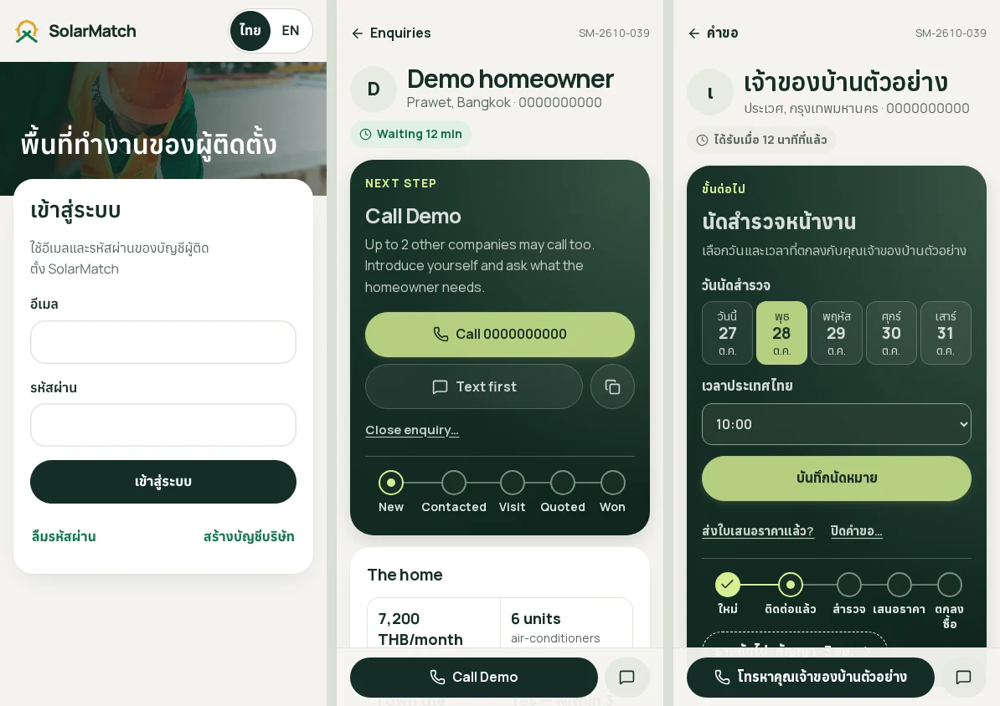

# SolarMatch Installers

Open `/installers/app` to go straight to the Thai installer workspace. Add `?lang=en` for English. Installers use their existing SolarMatch account and company permissions. The iOS, Android and home-screen versions all load this same first-party origin.



The enquiry and visit screenshots use fictional review data.

## Try it locally

From the repository root, use Node 22.13+ and pnpm. These commands create an isolated local database with a fictitious database ID. Use a fresh store name if you already have a preview you want to preserve.

```sh
pnpm install --frozen-lockfile
node scripts/installer-local-setup.mjs
pnpm exec wrangler d1 migrations apply solarmatch-installer-local-test --config .installer-test/wrangler.jsonc --local --persist-to .wrangler/installer-mobile-preview
INSTALLER_LOCAL_STORE=installer-mobile-preview INSTALLER_LOCAL_TEST=true pnpm dev --hostname localhost --port 3000
```

On Windows, keep the store name short (for example `installer-m1`): long paths exceed the Windows limit and SQLite fails with `unable to open database file`. If `pnpm dev` stalls while optimizing dependencies, use the compiled preview from [local testing](../docs/installer-local-test.md) instead: build with `INSTALLER_LOCAL_TEST=true pnpm build`, then `pnpm exec wrangler dev --config .installer-test/preview.jsonc --local --port 3000 --ip localhost --persist-to .wrangler/installer-m1`.

On PowerShell, set the two environment variables with `$env:INSTALLER_LOCAL_STORE='installer-mobile-preview'` and `$env:INSTALLER_LOCAL_TEST='true'`, then run `pnpm dev --hostname localhost --port 3000`. Open `http://localhost:3000/installers/app`. A new database starts without an approved installer. The existing [synthetic demonstration](../docs/installer-demo-local.md) creates an approved example company, enquiries and locally captured provider events. Run its setup only against this dedicated loopback store. Its generated credentials and invitations stay in ignored local files.

| Device | Local entry |
| --- | --- |
| Browser | Open the app URL above. Browsers offering home-screen installation use an installer-scoped manifest. A disconnected launch offers a retry and stores no enquiry pages. |
| iPhone simulator | Open the Xcode project under `mobile/ios` on a Mac, choose an iPhone simulator and run Debug. The simulator reaches the Mac’s loopback server. |
| Android emulator or USB device | Start the loopback server, run `adb reverse tcp:3000 tcp:3000`, then run the Debug app in Android Studio from `mobile/android`. |

A physical iPhone’s loopback address belongs to the phone. For later on-device iPhone testing, configure an owner-approved HTTPS test origin. Each release project requires the operator to choose its origin. The existing live portal is disabled.

## Field workflow

Open a waiting enquiry to call, record who answered, draft a text, book a visit in Thailand time, record a quote, or close and reopen the enquiry. The current action appears in the dark card. After a successful stage change, the installer has a short Undo window. Each write checks the current workflow revision. Team notes retain their own revision and autosave path.

Phone and SMS controls open the device’s dialer and composer. Opening Messages creates a composer activity. The installer decides whether to send the message. Browser calendar export creates a one-hour ICS file locally. The native apps hand off the appointment time to the device. Sharing in LINE passes only the staff access link following an explicit tap. The signed-in app retains the portal’s existing account, credit, claim, terms and LINE workflows.

Switching apps keeps work. Tapping Call stores only the enquiry’s opaque ID and start time (local storage, 30 minutes), so “How did the call go?” returns even if the phone closed the app during the call. Team notes save when the app leaves the screen. The Android app restores the open enquiry after the system ends it and replaces a stopped WebView renderer; the iOS app reopens the last installer page for 30 minutes and reloads after a web content crash, and follows the system text size. A failed save keeps the current step open and shows the reason inside the dark card.

Account deletion is under Company → Your account, and in the account menu. It needs the current password and erases the person’s sign-in at once. Public instructions are at `/installers/delete-account`.

Only company-owned, consented enquiry data can enter the current projection. Estimates are reconstructed from saved assessment answers when the calculator has the required inputs. The exact historical result shown in the homeowner’s browser is not stored on the server. An unavailable estimate is omitted. The home-screen worker serves a generic offline page on a failed app navigation. It does not cache documents, API responses, staff links, or writes.

## Store preparation

See [STORE_RELEASE.md](STORE_RELEASE.md) for the store requirements, what is done, the launch blockers in priority order and draft privacy answers. Store builds show credits without selling them.

Device checklist with the synthetic company, on each platform:

1. Sign in, open a waiting enquiry, tap Call and cancel in the dialer. Return: “How did the call go?” is showing. Repeat, and while the dialer is open force-stop the app (Android: Developer options → Don’t keep activities, or `adb shell am kill`); reopen and confirm the same enquiry and question return.
2. Record No answer; check the Thai SMS text arrives intact in Messages, then cancel without sending.
3. Book a visit for tomorrow 10:00; Add to calendar must show 10:00 in a Bangkok-time device, one hour long. Cancel.
4. Type a team note, switch to another app, come back: the note shows “Saved”.
5. Android Back from an enquiry returns to the list, then exits. iOS: the in-page back link returns to the list.
6. Keyboard: the notes box and quote amount stay visible above the keyboard.
7. Largest system text size (Android Font size, iOS Text Size and Larger Accessibility Sizes): no clipped buttons or sideways scrolling.
8. TalkBack and VoiceOver: the Next step card, stage track, close reasons and toasts are announced.
9. Airplane mode at launch shows the retry screen; turning it off and tapping Try again opens the workspace.
10. Delete a second synthetic account from Company → Your account; the app returns to sign-in and the account can no longer sign in.

Capture review screens with fictional data: `INSTALLER_APP_SCREENS=.wrangler/app-screens/review pnpm exec playwright test tests/e2e/installer-app-screens.spec.ts --project=mobile-chromium` against a running local preview. Keep the output outside `test-results`, which Playwright clears on every run.

- [App Store Review Guidelines](https://developer.apple.com/app-store/review/guidelines/)
- [Google Play payments policy](https://support.google.com/googleplay/android-developer/answer/9858738)
- [Google Play account deletion](https://support.google.com/googleplay/android-developer/answer/13327111)
- [SolarMatch installer launch readiness](../docs/launch-readiness/README.md)

## Design references

The owner’s *SolarMatch enquiry page: Next step design* supplies the enquiry workflow, bilingual copy and visual hierarchy. New Thai strings are drafts for native review. SolarQuotes’ installer feedback on showing suburb, claims and intake limits informed which jobs stay close to hand. Large labelled actions and a responsive layout support use in the field.

- [SolarQuotes installer app and version history](https://apps.apple.com/au/app/solarquotes/id1456563829)
- [W3C accessibility for older users](https://www.w3.org/WAI/older-users/)
- [Android touch targets](https://developer.android.com/guide/topics/ui/accessibility/apps)
